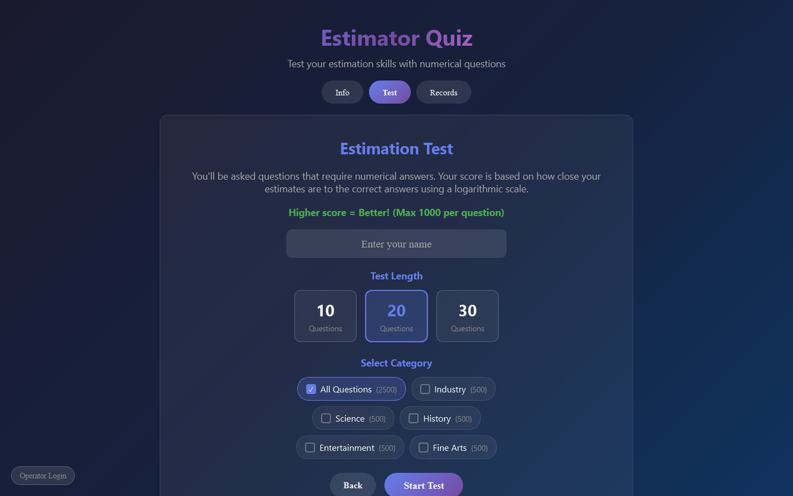
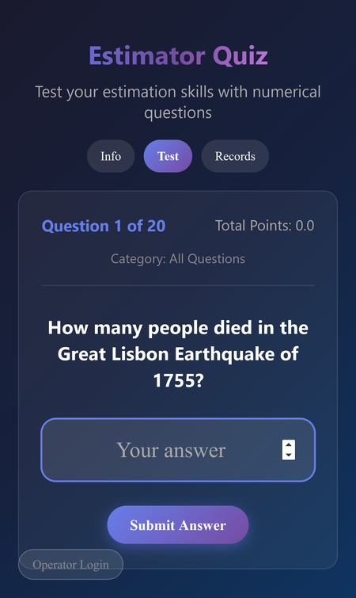

# Estimator Quiz

How good are you at guessing numbers? About 1,350 questions across Science, History, Industry, Fine Arts and Entertainment, scored by how close your estimate is on a logarithmic scale, with a shared leaderboard.

**[▶ Open the live app](https://timothyhadfield.github.io/Estimator_Quiz/Estimator_Quiz/)** · works on phone and laptop

  
  &nbsp;
  

## Features
- **Estimation mode**: type your best guess and score up to 1,000 points per question, based on how many "orders of magnitude" you are off (percentage questions use their own 100-point scale).
- **Daily Quiz**: the same 5 questions for everyone each day, one try, with a share button and a leaderboard for the day.
- **Accounts** (email or Google) that keep your daily history and past tests across devices.
- **Tests of 10, 20 or 30 questions**, with no repeats on your device until you've seen them all.
- **Self-balancing difficulty**: every question tracks how people score on it and gently adjusts its own difficulty to match the overall average.
- **Shared leaderboard**.
- **Report a question** if it's vague, too obscure or looks wrong.
- **Info tab** explaining the scoring formula with examples.

## Built with
A single HTML file (plain HTML, CSS and JavaScript, no build step) hosted on GitHub Pages, with questions, stats and leaderboards in a Firebase Realtime Database (free plan). The database rules live in [`database.rules.json`](database.rules.json): anyone can read, but players can only add answers, reports and leaderboard entries, never edit or delete questions.
